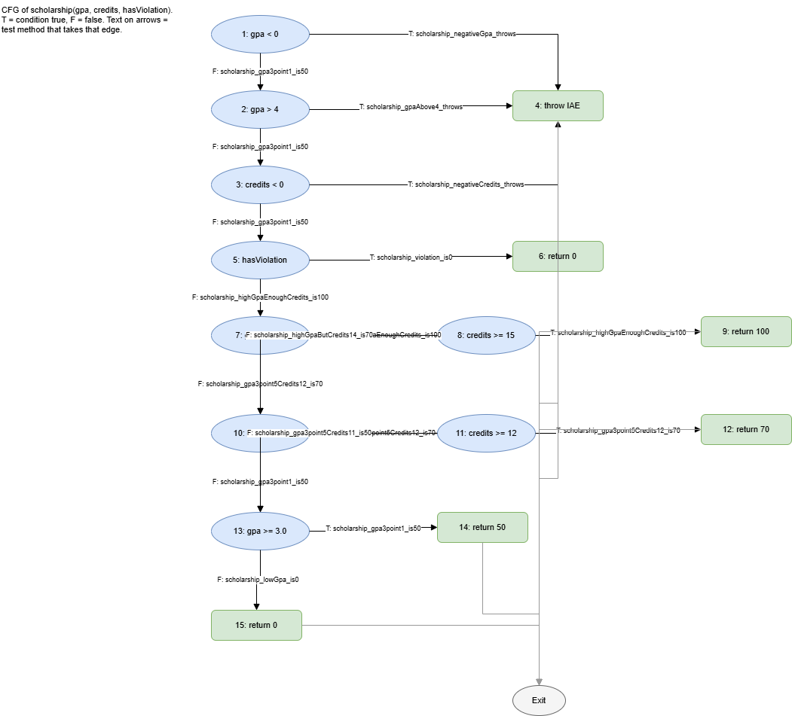

# Lab09 - Код хамралт: JaCoCo-гоор тестээ хөтлөх

Нэр: Ц.Төгөлдөр Оюутны код: B232270050

## Орчин

```
$ java -version
openjdk version "17.0.20.1" 2026-08-18
OpenJDK Runtime Environment (build 17.0.20.1+1-1-24.04-Ubuntu)
OpenJDK 64-Bit Server VM (build 17.0.20.1+1-1-24.04-Ubuntu, mixed mode, sharing)
```

```
$ mvn -version
Apache Maven 3.9.11 (3e54c93a704957b63ee3494413a2b544fd3d825b)
Maven home: /mnt/d/Program Files/Apache/Maven/apache-maven-3.9.11
Java version: 17.0.20.1, vendor: Ubuntu, runtime: /usr/lib/jvm/java-17-openjdk-amd64
Default locale: en, platform encoding: UTF-8
OS name: "linux", version: "6.18.58.1-microsoft-standard-wsl2", arch: "amd64", family: "unix"
```

## AI-ийн хэрэглээ

Тестүүдийн кодыг AI туслахтай (Claude) хамтран бичсэн. `cfg.png`-ийн анхны ноорог (зангилаа, ирмэг, ирмэг дээрх тестийн нэр)-ийг AI draw.io файл хэлбэрээр гаргасан; би draw.io-д нээж, ирмэг бүрийг `ScholarshipCalculator.java`-ийн 48-55-р мөртэй тулгаж, PNG болгон экспортолсон. Бүх `mvn` командыг өөрөө ажиллуулж, `results/` доторх гаралтыг өөрөө хадгалсан.

## Хэсэг A: happy path тестүүд ба эхний хэмжилт

5 happy-path тест (`ScholarshipCalculatorTest`): `letterGrade(95)`, `gpa([95,85])`, `scholarship(3.9,16,false)`, `scholarship(3.5,12,false)`, `scholarship(3.1,10,false)`. `results/mvn-verify-A.txt`: `Tests run: 5, Failures: 0`.

`results/jacoco-A.csv`-ээс: Line хамралт 16/(16+9) = **64%**, Branch хамралт 22/(22+19) = **53.7%** (BRANCH_COVERED 22, BRANCH_MISSED 19, LINE_COVERED 16, LINE_MISSED 9).

JaCoCo-ийн тайланд шар ромбо нь `if`-ийн зөвхөн нэг тал хамрагдсан хагас дутуу салаа: 20, 24, 31, 36, 48, 51, 52, 53, 54-р мөр (жишээ нь 20-р мөрийн `score < 0 || score > 100` зөвхөн false талаараа ажилласан). Улаан (огт хүрээгүй) 9 мөр нь алдааны замууд - `throw` мөрүүд (21, 32, 49), `C`/`D`/`F` дүнгийн замууд (25, 26, 27), switch-ийн `case "C"`, `case "D"` (39, 40) ба `scholarship()`-ийн эцсийн `return 0` (55) - энэ нь `LINE_MISSED = 9`-тэй таарна.

## Хэсэг B: CFG ба branch 100%

`scholarship()`-ийн CFG: 

Зангилаа бүр нь нөхцөл эсвэл return (1: `gpa < 0`, 2: `gpa > 4`, 3: `credits < 0`, 4: throw, 5: `hasViolation`, 6: return 0, 7: `gpa >= 3.8`, 8: `credits >= 15`, 9: return 100, 10: `gpa >= 3.4`, 11: `credits >= 12`, 12: return 70, 13: `gpa >= 3.0`, 14: return 50, 15: return 0); ирмэг бүрийн хажууд T/F ба түүнийг дайрч буй тестийн нэр бий.

Branch ба Line 100% хүртэл нийт **23 тест** шаардагдсан (`results/mvn-verify-B.txt`: `Tests run: 23, Failures: 0`). `results/jacoco-B.csv`: **BRANCH_MISSED = 0** (41/41), **LINE_MISSED = 0** (25/25).

## Хэсэг C: давталтын заагийн тестүүд

`gpa()`-ийн `for` давталтын 0 / 1 / 2+ тест:

- 0 удаа: `gpa_emptyArray_throws` (хоосон массив), `gpa_null_throws` (null) - хоёулаа `assertThrows(IllegalArgumentException.class, ...)`
- 1 удаа: `gpa_loopOneIteration_95_is4` - `gpa([95]) == 4.0`
- 2+ удаа: `gpa_loopManyIterations_fourGrades_is2point5` - `gpa([95,85,75,65]) == 2.5`

Эдгээр тест хамралтын тоог өсгөөгүй (хамралт аль хэдийн 100% байсан; Хэсэг C-ийн дараа нийт 25 тест). Гэхдээ хамралт нь мөр бүр ажилласныг л хэмждэг тул давталт 0, 1, олон удаа ажиллах үед ГОЛЧ зөв бодогдож байгааг (жишээ нь нэг дүнтэй үед хуваалт, хоосон оролтод exception) зөвхөн эдгээр заагийн тест шалгадаг.

## Хэсэг D: хамралт 100% - гэхдээ алдаа амьд

`letterGrade`-д 7 зааг утгын тест нэмсэн (60, 59.99, 69.99, 0, 100, 89.99, 90), нийт 32 тест. `results/mvn-test-D-fail.txt`: `Tests run: 32, Failures: 1`, `BUILD FAILURE`. Унасан тест:

```
ScholarshipCalculatorTest.letterGrade_boundary60_isD:155 expected: <D> but was: <F>
```

Алдаа: `ScholarshipCalculator.java`-ийн 26-р мөрөнд `if (score > 60)` гэж бичигдсэн, харин спецификаци 60-69.99-ийг "D" гэдэг тул `>= 60` байх ёстой. Засвар нь тусдаа commit: `53a0b61` "Fix letterGrade: > 60 -> >= 60, spec says 60 is D". Засвараас хойш `results/mvn-verify-final.txt`: `Tests run: 32, Failures: 0`, `BUILD SUCCESS`; `results/jacoco-final.csv`: BRANCH_MISSED = 0, LINE_MISSED = 0.

**Гол дүгнэлт.** Branch хамралт 100% (41/41) байхад энэ алдаа "үл үзэгдэгч" байсан, учир нь `score > 60` ба `score >= 60` хоёул ижил хоёр салааг (үнэн/худал) үүсгэдэг тул 65, 30 гэх мэт аль ч оноо хоёр салааг хоёуланг нь хамруулж, хамралтын тоо өөрчлөгддөггүй. Хамралт нь тестийн үед кодын аль мөр, аль салаа ажилласныг хэмждэг боловч ажилласан зам зөв үр дүн өгсөн эсэхийг шалгадаггүй. Алдааг зөвхөн зааг утга 60-ыг тусгайлан сонгосон тест (`letterGrade_boundary60_isD`) илрүүлсэн. Иймд хамралт нь тестээр хүрээгүй хэсгийг (улаан мөр, шар ромбо) олоход хэрэгтэй хэрэгсэл боловч "код зөв" гэсэн нотолгоо биш, зөв тест нь спецификацаас (зааг утгууд) гарах ёстой.

## Репозиторийн бүтэц

```
pom.xml
src/main/java/mn/edu/must/sqat/ScholarshipCalculator.java
src/test/java/mn/edu/must/sqat/ScholarshipCalculatorTest.java
cfg.png
results/mvn-verify-A.txt, jacoco-A.csv
results/mvn-verify-B.txt, jacoco-B.csv
results/mvn-test-D-fail.txt
results/mvn-verify-final.txt, jacoco-final.csv
README.md
.gitignore
```